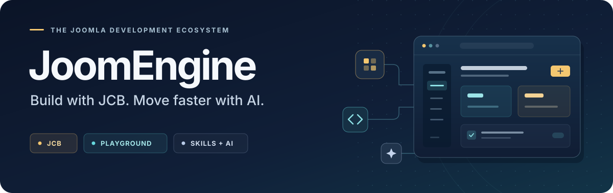

  

<h1 align="center">From your idea to a Joomla component.</h1>

  <strong>Joomla Component Builder. A browser workspace. Skills for your AI agent.</strong> 
  Everything working together to help you build, test and improve Joomla extensions faster.

  
  
  

  
  
  
  

## Meet JoomEngine

**JoomEngine brings Joomla Component Builder, Playground and AI Skills together to turn ideas into working Joomla components faster.** It is an open-source development ecosystem for people and agents building real Joomla applications.

Describe the component you need. Give your AI agent the JoomEngine Skills. Build on JCB's reusable fields, views, layouts, classes and component blueprints, then compile and test the result in Playground. Keep the editable JCB source alongside the installable extension so the next improvement starts from a solid foundation.

| 🧱 **JCB · The engine** | 🌐 **Playground · The workspace** | 🧠 **Skills · The AI workflow** |
| --- | --- | --- |
| Model your application, reuse proven features and compile native Joomla components, modules and plugins. | Run Joomla, JCB, PHP and MariaDB in your browser. Build, install and exercise your extension without setting up a local JCB server. | Guide your agent from requirements through implementation, testing and delivery, while keeping the source maintainable in JCB. |

**Less setup. More reuse. Faster iteration.** JCB provides the structure and compiler, Skills guide the work, and Playground makes the result tangible.

## 🧭 Quick access

| **What you're looking for** | **Start here** |
| --- | --- |
| 🚀 **Main JCB Engine & Source Code** | [Component Builder](https://git.vdm.dev/joomla/Component-Builder) · [GitHub Mirror](https://github.com/joomengine/Joomla-Component-Builder) |
| 📦 **Download the JCB Installer Package** | [Stable Releases](https://git.vdm.dev/joomla/pkg-component-builder/releases) · [J6 Nightly](https://github.com/joomengine/pkg-component-builder/archive/refs/heads/6.x.zip) · [J5](https://github.com/joomengine/pkg-component-builder/archive/refs/heads/5.x.zip) · [J4](https://github.com/joomengine/pkg-component-builder/archive/refs/heads/4.x.zip) |
| 🌐 **Open JoomEngine Playground** | [Launch Playground](https://playground.joomengine.org/) · [Playground Agent Guide](https://github.com/joomengine/skills/blob/main/testing/playground/README.md) |
| 🎯 **Set Up JCB Locally** | [OctoJoom](https://git.vdm.dev/octoleo/octojoom) |
| 🐳 **JCB Docker Images** | [Repository](https://github.com/joomengine/docker/tree/master/docker) · [Images](https://hub.docker.com/r/octoleo/joomengine) |
| 💼 **JCB Packages** [🛈](https://github.com/orgs/joomengine/discussions/995) | [Packages](https://github.com/joomengine/packages) · [Joomla Packages](https://github.com/joomengine/joomla-packages) |
| 🧠 **JoomEngine AI Skills** | [Skills Repository](https://github.com/joomengine/skills) · [From Request to Extension](https://github.com/joomengine/skills/blob/main/workflows/request-to-extension.md) |
| 📚 **Documentation** | [JCB Documentation & Onboarding Guide](https://github.com/joomengine/jcb-documentation/blob/master/english/README.md) |
| 🐞 **Report Bugs or Request Features** | [New JCB Issue](https://git.vdm.dev/joomla/Component-Builder/issues/new/choose) · [All JCB Issues](https://git.vdm.dev/joomla/Component-Builder/issues) |
| 💬 **Community Support & Chat** | [Telegram Group](https://t.me/jcb_group) · [Announcements](https://t.me/Joomla_component_builder) · [JoomlaCommunity Mattermost](https://joomlacommunity.cloud.mattermost.com/main/channels/jcb) |
| 💡 **Ask or Answer Questions** | [GitHub Discussions](https://github.com/orgs/joomengine/discussions) |
| 🌐 **Network & APIs** | [Service Status](https://status.vdm.dev/status/jcb) · [JCB API](https://api.joomlacomponentbuilder.com/v1/network/community/jcb) · [SuperPowers API](https://api.joomlacomponentbuilder.com/v1/network/community/jcb/super-powers) |
| 🤝 **Contribute to JCB** | [Contribution Guide](https://git.vdm.dev/joomla/Component-Builder/src/branch/5.x/.github/CONTRIBUTING.md) |

## ⚡ From a prompt to a working component

1. **Describe what you want to build.** Set out the records, relationships, screens, permissions and workflows your application needs.
2. **Give your agent the [JoomEngine Skills](https://github.com/joomengine/skills).** The workflow guides it through reusable JCB features, component design and the custom behaviour your application needs.
3. **Build and test in [Playground](https://playground.joomengine.org/).** Use a browser-capable agent to work in a real Joomla environment, compile with JCB, install the extension and exercise its features.
4. **Take your work with you.** Deliver the Joomla installer, preserve the editable JCB blueprint and export a complete Playground site for continued development.

### Try a first prompt

> Use https://github.com/joomengine/skills to build a Joomla component in JoomEngine Playground for equipment loans. Manage equipment, borrowers, reservations and returns. Prevent overlapping reservations, provide administrator screens and a frontend request form, and apply appropriate access permissions. Compile and install it, test the main workflows, and give me the Joomla installer, editable JCB blueprint and complete site export.

Start with the [request-to-extension workflow](https://github.com/joomengine/skills/blob/main/workflows/request-to-extension.md) for the full process, or use the [Playground agent guide](https://github.com/joomengine/skills/blob/main/testing/playground/README.md) for the browser workspace.

## 🤝 Build with the community

JoomEngine grows through real projects, shared knowledge and reusable work. Bring your component idea, improve a Skill, contribute a Power or blueprint, help with documentation, or share what you learned building with JCB.

**[Join the conversation](https://github.com/orgs/joomengine/discussions)** · **[Chat on Telegram](https://t.me/jcb_group)** · **[Follow announcements](https://t.me/Joomla_component_builder)** · **[Support JCB](https://opencollective.com/joomla-component-builder)**

---

  <strong>Your ideas. JCB's engine. A faster way to build for Joomla.</strong> 
  <a href="https://playground.joomengine.org/">Open Playground</a> · <a href="https://github.com/joomengine/skills">Explore the Skills</a> · <a href="https://www.joomlacomponentbuilder.com">Discover JCB</a>

